  <picture>
    <source media="(prefers-color-scheme: dark)" srcset="assets/hero-dark.svg" />
    <source media="(prefers-color-scheme: light)" srcset="assets/hero-light.svg" />
    
  </picture>

    

  
  
  
  

---

## Sobre Mim

Graduando em **Ciência da Computação na Universidade Estadual do Sudoeste da Bahia (UESB)**, com atuação direcionada para **Engenharia de Inteligência Artificial, LLMs, Processamento de Linguagem Natural (NLP), Machine Learning e Sistemas de Agentes**.

Acumulo **1.306 horas** de experiência prática na **Residência em Software TIC 36 (SETRE/Governo da Bahia · MCTI)**, integrando Ciência de Dados (560h) e desenvolvimento de software em equipe (746h), somadas à atuação técnica em infraestrutura, sistemas Linux e manutenção de hardware. Busco oportunidades (**estágio, posição júnior ou pesquisa aplicada**) para transformar modelos de IA e pipelines de dados em sistemas confiáveis, auditáveis e de impacto real.

---

## Foco Atual em IA & Engenharia

- **Engenharia de LLMs & RAG**: Arquitetura de pipelines de geração aumentada por recuperação, embeddings vetoriais, roteamento multi-modelo e *guardrails* de segurança.
- **Agentes Inteligentes & Ferramentas (MCP)**: Construção de fluxos agênticos com memória estruturada, uso determinístico de ferramentas e integração entre modelos e aplicações.
- **NLP & Machine Learning Aplicado**: Pré-processamento e vetorização textual, classificação, análise preditiva, redes neurais e avaliação rigorosa de métricas.
- **Infraestrutura para IA Auto-hospedada**: Inferência local compatível com Ollama, APIs em Python e Go, PostgreSQL e implantação reproduzível via Docker Compose.

---

## Projeto em Destaque

### [NÓDULO (`nodulo-os/nodulo`)](https://github.com/nodulo-os/nodulo) · [Organização `nodulo-os`](https://github.com/nodulo-os)

  <a href="https://github.com/nodulo-os/nodulo">
    <picture>
      <source media="(prefers-color-scheme: dark)" srcset="https://readme-zeta-ten.vercel.app/api/pin/?username=nodulo-os&repo=nodulo&show_owner=true&bg_color=0D1117&title_color=38BDF8&text_color=C9D1D9&icon_color=34D399&border_color=30363D&border_radius=10" />
      <source media="(prefers-color-scheme: light)" srcset="https://readme-zeta-ten.vercel.app/api/pin/?username=nodulo-os&repo=nodulo&show_owner=true&bg_color=F6F8FA&title_color=0284C7&text_color=1F2328&icon_color=059669&border_color=D0D7DE&border_radius=10" />
      
    </picture>
  </a>

 

- **Proposta e Soberania de Dados**: Plataforma de Inteligência Artificial voltada a universidades, escolas, empresas e pessoas que priorizam autonomia digital, permitindo controlar onde a IA executa, quem acessa e como os dados são administrados — sem venda ou monetização de conversas e documentos.
- **Inferência & RAG**: Integração configurável com o protocolo compatível com **Ollama** para execução de modelos abertos (como *Llama* e *Qwen*) e pipeline **RAG** baseado em embeddings de **768 dimensões**.
- **Arquitetura em Produção**: Backend concorrente em **Go** com migrações automatizadas, interface web em **Next.js / TypeScript**, persistência em **PostgreSQL** e empacotamento com **Docker Compose** e suporte a **Coolify**.
- **Atuação**: Membro da organização [`nodulo-os`](https://github.com/nodulo-os).

---

## Stack Técnica

| Domínio | Tecnologias & Competências |
| :--- | :--- |
| **IA, LLMs & Dados** | `Python` · `LLMs & RAG` · `NLP` · `Agentes & MCP` · `Ollama` · `Scikit-learn` · `TensorFlow` · `Pandas` · `NumPy` |
| **Backend & Dados** | `FastAPI` · `Flask` · `Go` · `Java 21` · `Spring Boot` · `PostgreSQL` · `SQL` · `APIs REST` |
| **Web & Interfaces** | `TypeScript` · `Next.js` · `JavaScript` · `HTML5 / CSS3` |
| **Infraestrutura & Engenharia** | `Docker` · `Docker Compose` · `Linux` · `Git` · `Testes Automatizados` · `Scrum` · `Kanban` |

---

## Experiência & Formação

- **Residência em Software TIC 36 — Fase 2 (746h)** · *SETRE / Governo da Bahia · MCTI* (`jan–out 2025`)
  Desenvolvimento de software em equipe para soluções reais do setor público, atuando em APIs REST com Java 21, Spring Boot, PostgreSQL, autenticação OAuth2, documentação OpenAPI, testes e fluxos ágeis (Scrum/Kanban).
- **Residência em Software TIC 36 — Fase 1 (560h)** · *Ciência de Dados & Empreendedorismo · MCTI* (`jul–dez 2024`)
  Análise exploratória de dados, modelagem preditiva com Python e estruturação de soluções tecnológicas orientadas a problema real.
- **Bacharelado em Ciência da Computação** · *UESB — Vitória da Conquista, BA* (`Em andamento`)
  Base sólida em algoritmos, inteligência artificial, processamento de linguagem natural, modelagem de dados e sistemas concorrentes.
- **Técnico em TI (Atuação Independente)**
  Diagnóstico e manutenção de hardware, instalação e administração de sistemas Linux e Windows e suporte técnico completo.

---

## Métricas & Atividade no GitHub

  <picture>
    <source media="(prefers-color-scheme: dark)" srcset="https://readme-zeta-ten.vercel.app/api?username=WillianRullian&show_icons=true&include_all_commits=true&hide_rank=true&hide=stars,issues&show=prs_merged&locale=pt-br&custom_title=Atividade%20no%20GitHub&card_width=380&bg_color=0D1117&title_color=38BDF8&text_color=C9D1D9&icon_color=34D399&border_color=30363D&border_radius=10" />
    <source media="(prefers-color-scheme: light)" srcset="https://readme-zeta-ten.vercel.app/api?username=WillianRullian&show_icons=true&include_all_commits=true&hide_rank=true&hide=stars,issues&show=prs_merged&locale=pt-br&custom_title=Atividade%20no%20GitHub&card_width=380&bg_color=F6F8FA&title_color=0284C7&text_color=1F2328&icon_color=059669&border_color=D0D7DE&border_radius=10" />
    
  </picture>
  <picture>
    <source media="(prefers-color-scheme: dark)" srcset="https://readme-zeta-ten.vercel.app/api/top-langs/?username=WillianRullian&owner_affiliations=OWNER,COLLABORATOR,ORGANIZATION_MEMBER&exclude_repo=readme&hide=jupyter%20notebook,html,css,shell&size_weight=0.5&count_weight=0.5&layout=compact&langs_count=6&custom_title=Principais%20Linguagens&card_width=380&bg_color=0D1117&title_color=38BDF8&text_color=C9D1D9&icon_color=34D399&border_color=30363D&border_radius=10" />
    <source media="(prefers-color-scheme: light)" srcset="https://readme-zeta-ten.vercel.app/api/top-langs/?username=WillianRullian&owner_affiliations=OWNER,COLLABORATOR,ORGANIZATION_MEMBER&exclude_repo=readme&hide=jupyter%20notebook,html,css,shell&size_weight=0.5&count_weight=0.5&layout=compact&langs_count=6&custom_title=Principais%20Linguagens&card_width=380&bg_color=F6F8FA&title_color=0284C7&text_color=1F2328&icon_color=059669&border_color=D0D7DE&border_radius=10" />
    
  </picture>

   

  <picture>
    <source media="(prefers-color-scheme: dark)" srcset="https://readme-zeta-ten.vercel.app/api/streak?username=WillianRullian&locale=pt-br&custom_title=Consist%C3%AAncia%20no%20GitHub&bg_color=0D1117&title_color=38BDF8&text_color=C9D1D9&icon_color=34D399&ring_color=38BDF8&border_color=30363D&border_radius=10" />
    <source media="(prefers-color-scheme: light)" srcset="https://readme-zeta-ten.vercel.app/api/streak?username=WillianRullian&locale=pt-br&custom_title=Consist%C3%AAncia%20no%20GitHub&bg_color=F6F8FA&title_color=0284C7&text_color=1F2328&icon_color=059669&ring_color=0284C7&border_color=D0D7DE&border_radius=10" />
    
  </picture>

---

## Contato

Aberto a conexões com **recrutadores, lideranças técnicas e pesquisadores** em **Engenharia de IA, LLMs, Ciência de Dados e Engenharia de Software**.

- **LinkedIn**: [linkedin.com/in/willian-rullian-ferreira-dos-anjos-b45155175](https://www.linkedin.com/in/willian-rullian-ferreira-dos-anjos-b45155175/)
- **Email**: [niltomwr@gmail.com](mailto:niltomwr@gmail.com)
- **GitHub**: [github.com/WillianRullian](https://github.com/WillianRullian)

 

  <picture>
    <source media="(prefers-color-scheme: dark)" srcset="assets/footer-dark.svg" />
    <source media="(prefers-color-scheme: light)" srcset="assets/footer-light.svg" />
    
  </picture>

